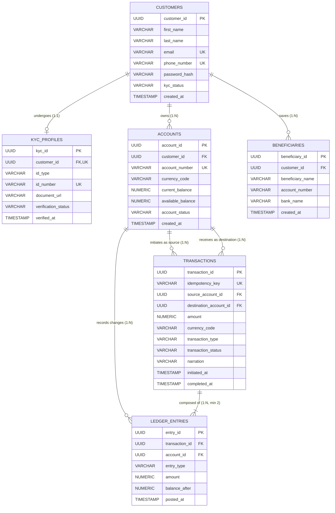

# Portfolio 1: Database Design and Modelling

**Course:** MIT 8103 – Advanced Database Systems  
**Academic Session:** 2026/2027  
**Case Study Organisation:** PaySphere Financial Technologies Ltd.  
**Module Directory:** `portfolio-1-database-design/`  

---

## 1. Case Study Specification

### 1.1 Organisation Profile & System Overview
**PaySphere Financial Technologies Ltd.** is a licensed Tier-1 digital payment service provider and neo-banking institution. The platform provides real-time peer-to-peer (P2P) transfers, multi-currency customer wallets, automated merchant settlement, and institutional utility payments. 

To guarantee regulatory compliance (Central Bank operational guidelines and AML/CFT regulations) and prevent balance discrepancies, PaySphere implements a strict **immutable double-entry ledger architecture**. Every monetary movement requires at least two balanced ledger postings: one debit and one credit.

### 1.2 Database Actors and Users
* **Retail Customers & Merchants:** Initiate transfers, review real-time balances, generate periodic account statements, and manage saved beneficiaries.
* **Payment Gateway Engine:** Automated background processing service executing idempotent API calls, debiting/crediting accounts, and writing immutable ledger entries.
* **Compliance & AML Officers:** Audit transaction volumes, investigate suspicious activities, and review Know-Your-Customer (KYC) documentation.
* **Operations & Finance Personnel:** Run end-of-day (EOD) reconciliation jobs, audit system-wide ledger balance integrity, and process dispute reversals.
* **Database Administrator (DBA):** Manages replication topology, indexing strategies, user permissions, and connection pooling.

### 1.3 Major Data Entities
* **`CUSTOMERS`**: Stores profile information, contact details, account tiers, and access credentials.
* **`KYC_PROFILES`**: Stores regulatory identity verification data (1:1 with Customers).
* **`ACCOUNTS`**: Holds multi-currency balances with status flags (`ACTIVE`, `FROZEN`, `DORMANT`).
* **`TRANSACTIONS`**: High-level payment order records containing amounts, fees, and idempotency keys.
* **`LEDGER_ENTRIES`**: Immutable, balanced debit and credit entries tied directly to transaction records.
* **`BENEFICIARIES`**: Directory of whitelisted counterparty accounts saved by customers for recurring transfers.

### 1.4 Key Supported Operations
1. **Atomic Fund Transfers:** Execute transfers between accounts with zero balance drift.
2. **Double-Entry Balance Validation:** Enforce that $\sum \text{Debits} = \sum \text{Credits}$ for every completed transaction.
3. **Real-time Balance Enquiry:** Fast lookup of ledger records and current account balances.
4. **Concurrency Protection:** Row-level locking during transfers to prevent double-spending or race conditions.

---

## 2. Conceptual Design: Entity-Relationship (ER) Diagram



---

## 3. Normalisation Breakdown (UNF to BCNF)

### 3.1 Unnormalised Form (UNF)
In an unnormalised legacy ledger, data is collected in flat, redundant records containing nested repeating groups:

> `UNF_RECORD` = { **CustID**, CustName, CustPhone, KYC_Details, [Accounts, Balances], [TxnID, DestAccount, Amount, Postings], [SavedBeneficiaries] }

* **Violations:** Multi-valued attributes (`Accounts`, `Balances`), nested repeating transaction arrays, and non-atomic customer fields.

---

### 3.2 First Normal Form (1NF)
* **Rule:** Eliminate repeating groups, ensure all attributes are atomic, and designate primary keys.
* Customer name is decomposed into `first_name` and `last_name`.
* Repeating transactional postings and counterparty accounts are isolated into distinct tabular structures.

```text
CUSTOMERS_1NF (customer_id [PK], first_name, last_name, email, phone_number, tier_level, kyc_status)
ACCOUNTS_1NF  (account_id [PK], customer_id [FK], account_number, currency_code, current_balance)
TRANSACTIONS_1NF (transaction_id [PK], entry_id [PK], source_acc, dest_acc, amount, entry_type, posted_at)
```

---

### 3.3 Second Normal Form (2NF)
* **Rule:** Must satisfy 1NF and contain **no partial functional dependencies** (every non-key attribute must depend fully on the primary key).
* In `TRANSACTIONS_1NF`, the composite key `{transaction_id, entry_id}` violates 2NF because:
  * `{amount, source_acc, dest_acc}` depends only on `{transaction_id}`.
  * `{entry_type, balance_after, posted_at}` depends on `{entry_id}`.
* **Resolution:** Decomposed into two relations:
  1. `TRANSACTIONS` (Key: `transaction_id`)
  2. `LEDGER_ENTRIES` (Key: `entry_id`)

---

### 3.4 Third Normal Form (3NF)
* **Rule:** Must satisfy 2NF and contain **no transitive dependencies** ($X \rightarrow Y$ and $Y \rightarrow Z$, where non-key attributes determine other non-key attributes).
* **Transitive Dependency 1 (KYC Verification):**
  * In customer profiles: `customer_id` $\rightarrow$ `id_number` $\rightarrow$ `{id_type, verification_status}`.
  * *Resolution:* Extracted into the separate `KYC_PROFILES` relation.
* **Transitive Dependency 2 (Beneficiary Details):**
  * `customer_id` $\rightarrow$ `beneficiary_account` $\rightarrow$ `{bank_name, bank_code}`.
  * *Resolution:* Extracted into the `BENEFICIARIES` table.

---

### 3.5 Boyce-Codd Normal Form (BCNF)
* **Rule:** For every functional dependency $X \rightarrow Y$, the determinant $X$ must be a **superkey**.
* **Analysis of `ACCOUNTS` Table:**
  * Candidate Keys: `{account_id}`, `{account_number}`
  * Functional Dependencies:
    * `account_id` $\rightarrow$ `{customer_id, account_number, currency_code, current_balance}`
    * `account_number` $\rightarrow$ `{customer_id, currency_code, current_balance}`
  * Both determinants are candidate keys. $\rightarrow$ **Satisfies BCNF**.
* **Analysis of `TRANSACTIONS` Table:**
  * Candidate Keys: `{transaction_id}`, `{idempotency_key}`
  * Both determinants are superkeys. $\rightarrow$ **Satisfies BCNF**.

**Conclusion:** The database schema is fully BCNF-compliant and free of insert, update, or delete anomalies.

---

## 4. Implementation Scripts in this Directory

* **`01_schema_definition.sql`**: Production DDL script containing PostgreSQL table definitions, keys, constraints, and data validations.
* **`02_sample_seed.sql`**: Deterministic sample records verifying relational integrity and double-entry balance consistency.
